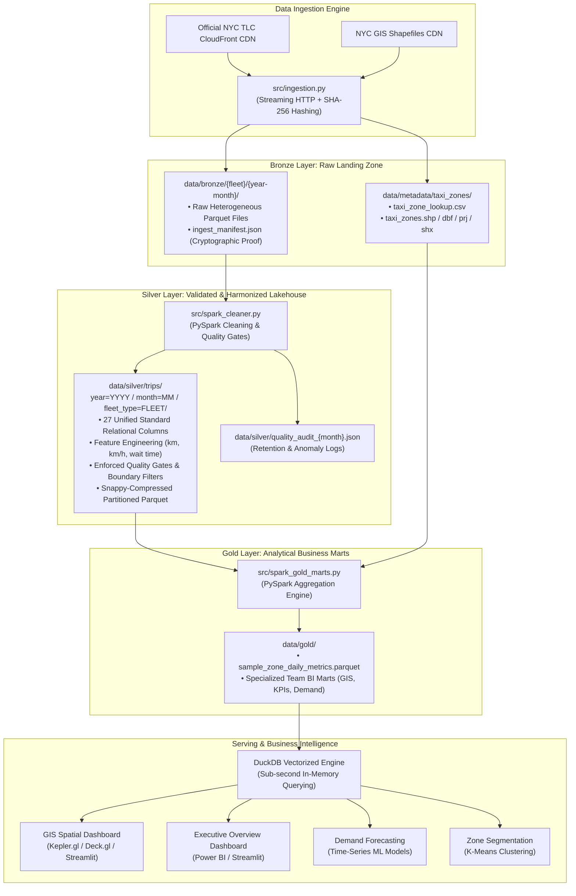

# NYC TLC Big Data Lakehouse Pipeline & Analytical Platform

An enterprise-grade, end-to-end Big Data Engineering pipeline built on **Apache Spark (PySpark)**, **DuckDB**, and **Apache Parquet**, implementing the **Medallion Lakehouse Architecture** on New York City Taxi & Limousine Commission (NYC TLC) trip records and GIS spatial datasets.

---

## 1. Lakehouse Architecture: The Medallion Paradigm

This project structures data into three progressive, decoupled layers ensuring strict Data Lineage, Schema Governance, Quality Gates, and sub-second analytical querying.



### Layer Details:
1. **Bronze Layer (`data/bronze/`)**:
   - **Source of Truth**: Immutable raw Parquet files downloaded directly from official NYC TLC CloudFront servers.
   - **Integrity**: Streaming downloads verify cryptographic **SHA-256 checksums** on-the-fly and generate `ingest_manifest.json` for auditing.
   - **Multi-Fleet Support**: Covers all 4 regulated fleets: Yellow Medallion, Green Boro Taxi, For-Hire Vehicle (FHV), and High-Volume For-Hire Vehicle (FHVHV - Uber/Lyft).

2. **Silver Layer (`data/silver/`)**:
   - **Schema Harmonization**: Bridges heterogeneous fleet schemas (divergent column naming, differing surcharge structures) into a unified master 27-column relational schema.
   - **Feature Engineering**: Computes dual-unit distances (`miles` & `km`), velocities (`mph` & `km/h`), trip durations (`minutes`), and passenger wait times (`minutes`).
   - **Quality Gates**: Filters out corrupt records (negative fares/tips, duration anomalies $< 30$ seconds or $> 24$ hours, GPS teleportation $> 100$ mph, out-of-month dates, and invalid passenger counts).
   - **Partitioned Storage**: Partitioned by `year=YYYY / month=MM / fleet_type=FLEET` for high-throughput Partition Pruning during analytical queries.

3. **Gold Layer (`data/gold/`)**:
   - **High-Performance Aggregations**: Pre-computed multi-dimensional analytical marts joined with GIS metadata (`taxi_zone_lookup.csv`).
   - **Optimized for Dashboards**: Compressed into compact Parquet files (`coalesce(1)`), eliminating Spark JVM overhead during dashboard interactions.

---

## 2. Repository Structure & Component Guide

```text
NYC_TLC/
├── data/
│   ├── bronze/                      # Immutable raw Parquet and manifests
│   │   ├── yellow/YYYY-MM/          # Yellow taxi raw parquet
│   │   ├── green/YYYY-MM/           # Green boro taxi raw parquet
│   │   ├── fhv/YYYY-MM/             # Traditional For-Hire Vehicle parquet
│   │   └── fhvhv/YYYY-MM/           # Uber/Lyft high-volume parquet
│   ├── silver/
│   │   ├── trips/                   # Partitioned clean Parquet lakehouse
│   │   │   └── year=YYYY/month=MM/fleet_type=FLEET/part-*.parquet
│   │   └── quality_audit_*.json     # Monthly quality gate retention audit logs
│   ├── gold/                        # Compact aggregated marts for dashboards
│   │   └── sample_zone_daily_metrics.parquet
│   └── metadata/taxi_zones/         # Official TLC GIS spatial reference data
│       ├── taxi_zone_lookup.csv     # Mapping: LocationID -> Borough, Zone, Service Zone
│       └── taxi_zones.*             # Shapefile GIS layers (.shp, .dbf, .prj, .shx)
├── logs/                            # Centralized process execution logs
├── src/
│   ├── config.py                    # Centralized settings, fleet schemas & thresholds
│   ├── ingestion.py                 # Bronze ingestion engine & GIS shapefile extraction
│   ├── spark_cleaner.py             # Silver PySpark cleansing, harmonization & Quality Gates
│   └── spark_gold_marts.py          # Gold analytical marts aggregation template
├── requirements.txt                 # Pinned project dependencies
├── run_pipeline.py                  # CLI Master Orchestrator for end-to-end execution
└── README.md                        # Project documentation and team user guide
```

### Module Descriptions:
* **`src/config.py`**: Central registry defining system paths, CloudFront URLs, full schema mappings across all 4 fleets, boundary thresholds (`MAX_SPEED_MPH = 100`, `MIN_DURATION_MINUTES = 0.5`, `UNKNOWN_ZONE_ID = 264`), and Spark hardware parameters.
* **`src/ingestion.py`**: Autonomous downloader with chunked streaming HTTP, retry logic, custom User-Agents, SHA-256 fingerprint generation, and automated ZIP unzipping with GIS shapefile directory flattening.
* **`src/spark_cleaner.py`**: Distributed data cleaning engine. Initializes an optimized SparkSession, dynamically projects fleet columns into 27 standard columns, computes operational features, enforces rigorous Quality Gates, and writes partitioned Parquet with dynamic partition overwriting.
* **`src/spark_gold_marts.py`**: Aggregation pipeline joining Silver trips with GIS spatial metadata to generate compact business marts ready for BI and machine learning.
* **`run_pipeline.py`**: Production CLI orchestrator supporting single-month, multi-month date ranges (`--range`), whole-year execution (`--year`), step-bypassing (`--skip-ingest`), and safe lakehouse re-runs (`--clean-all`).

---

## 3. Environment Setup & Prerequisites

### Requirements:
* **Operating System**: Windows, macOS, or Linux
* **Python**: `3.10`, `3.11`, or `3.12`
* **Java**: `Java JRE / JDK 17, 21, or 23` (Required for Apache Spark)

### Installation & Virtual Environment Setup:

To isolate project dependencies and avoid polluting your global Python environment, always use a virtual environment:

1. **Clone the repository and enter the project directory:**
   ```bash
   git clone <REPOSITORY_URL>
   cd NYC_TLC
   ```

2. **Create and activate an isolated virtual environment (`.venv`):**
   * **On Windows (PowerShell):**
     ```powershell
     python -m venv .venv
     .\.venv\Scripts\Activate.ps1
     ```
   * **On macOS / Linux:**
     ```bash
     python3 -m venv .venv
     source .venv/bin/activate
     ```

3. **Install dependencies from `requirements.txt`:**
   ```bash
   pip install --upgrade pip
   pip install -r requirements.txt
   ```

> [!NOTE]
> **Windows Compatibility**: On Windows machines, Apache Spark requires `winutils.exe` and `hadoop.dll` for writing Parquet files. Our pipeline includes an **automatic bootstrapper** (`ensure_windows_hadoop_env()`) that detects Windows, downloads the required micro-binaries into `tools/hadoop/bin`, and configures `HADOOP_HOME` automatically on first run. No manual setup is required!

---

## 4. Execution Guide (CLI Pipeline)

### Option A: Master Pipeline Orchestrator (`run_pipeline.py`)

Run the complete Bronze $\to$ Silver $\to$ Gold lifecycle through a single command:

```bash
# 1. Process a single target month (Default: 2025-01):
python run_pipeline.py --month 2025-01

# 2. Process a multi-month range (e.g. 4 months from January to April 2025):
python run_pipeline.py --range 2025-01 2025-04

# 3. Process an entire year:
python run_pipeline.py --year 2024

# 4. Clean and re-run Silver and Gold layers from scratch (retaining raw Bronze downloads):
python run_pipeline.py --month 2025-01 --clean-all

# 5. Skip already ingested raw data and only run Silver + Gold:
python run_pipeline.py --month 2025-01 --skip-ingest
```

### Option B: Standalone Module Execution

Each module can be independently executed, debugged, or unit-tested:

```bash
# Ingest raw Bronze Parquet and GIS Shapefiles:
python -m src.ingestion --month 2025-01 --fleets yellow green fhv fhvhv

# Clean & Harmonize Silver Lakehouse:
python -m src.spark_cleaner --month 2025-01 --fleets yellow green fhv fhvhv

# Aggregate Gold Analytical Marts:
# Single month:
python -m src.spark_gold_marts --month 2025-01
# Or aggregate the entire multi-month Silver horizon:
python -m src.spark_gold_marts --month all
```

---

## 5. Team Guide: How to Build Custom Gold Marts for Dashboards

Team members can add specialized analytical marts for their respective dashboards by adding aggregation functions to `src/spark_gold_marts.py`.

### Step-by-Step Implementation Pattern:

1. Open `src/spark_gold_marts.py`.
2. Define your mart aggregation function taking `silver_df` and `zone_lookup_df`.
3. Use PySpark DataFrame functions or pure Spark SQL to aggregate metrics.
4. Save the result to `GOLD_DIR / "your_mart_name.parquet"` using `.coalesce(1)`.

#### Example 1: Building a GIS Origin-Destination Mart (`gold_od_matrix.parquet`)
*Useful for Flow Maps, Trip Arcs, and Inter-borough mobility analysis:*

```python
def build_gis_od_matrix(spark: SparkSession, silver_df: DataFrame) -> Path:
    """Aggregates Origin-Destination (Pickup -> Dropoff) traffic flows for GIS mapping."""
    logger.info("Building GIS OD Matrix Mart...")

    od_matrix_df = (
        silver_df.filter("pickup_zone_id != 264 AND dropoff_zone_id != 264")
        .groupBy("pickup_zone_id", "dropoff_zone_id", "fleet_type")
        .agg(
            F.count("*").alias("trip_count"),
            F.round(F.avg("trip_distance_km"), 2).alias("avg_distance_km"),
            F.round(F.avg("trip_duration_minutes"), 2).alias("avg_duration_minutes"),
            F.round(F.avg("speed_kmh"), 2).alias("avg_speed_kmh"),
        )
        .orderBy(F.col("trip_count").desc())
    )

    output_path = GOLD_DIR / "gold_od_matrix.parquet"
    od_matrix_df.coalesce(1).write.mode("overwrite").parquet(str(output_path))
    return output_path
```

#### Example 2: Building an Hourly Demand Forecasting Mart (`gold_hourly_demand.parquet`)
*Useful for Time-Series forecasting, peak hour analysis, and fleet dispatching:*

```python
def build_hourly_demand_mart(spark: SparkSession, silver_df: DataFrame) -> Path:
    """Aggregates hourly trip counts by pickup zone for time-series forecasting models."""
    logger.info("Building Hourly Demand Mart...")

    hourly_df = (
        silver_df.withColumn("pickup_hour", F.hour("pickup_at"))
        .withColumn("pickup_date", F.to_date("pickup_at"))
        .withColumn("day_of_week", F.dayofweek("pickup_at"))
        .groupBy("pickup_date", "pickup_hour", "day_of_week", "pickup_zone_id", "fleet_type")
        .agg(
            F.count("*").alias("demand_trips"),
            F.round(F.avg("fare_amount"), 2).alias("avg_fare"),
        )
        .orderBy("pickup_date", "pickup_hour", "pickup_zone_id")
    )

    output_path = GOLD_DIR / "gold_hourly_demand.parquet"
    hourly_df.coalesce(1).write.mode("overwrite").parquet(str(output_path))
    return output_path
```

---

## 6. How to Connect Dashboards to Gold Marts

Dashboards (Streamlit, Dash, Power BI) **do not need to start Apache Spark**. Instead, they achieve sub-second queries directly over the Gold Parquet files using **DuckDB**.

### 1. In Python / Streamlit (Sub-Second Latency):
```python
import duckdb
import streamlit as st

# Query directly from Parquet into a Pandas DataFrame in ~10 milliseconds
con = duckdb.connect()
query = """
    SELECT 
        pickup_borough,
        SUM(total_trips) AS total_trips,
        ROUND(AVG(avg_speed_kmh), 2) AS avg_speed_kmh,
        ROUND(SUM(total_revenue_usd), 2) AS total_revenue
    FROM 'data/gold/sample_zone_daily_metrics.parquet'
    GROUP BY 1
    ORDER BY total_trips DESC
"""
df = con.execute(query).df()

# Display in Streamlit
st.title("NYC TLC Executive Overview")
st.dataframe(df)
st.bar_chart(data=df, x="pickup_borough", y="total_trips")
```

### 2. In Power BI:
1. Open Power BI Desktop.
2. Select **Get Data** $\to$ **Parquet**.
3. Browse and select `data/gold/sample_zone_daily_metrics.parquet`.
4. Power BI imports the aggregated table in seconds with full columnar compression.

---

## 7. Quality Gates & Verified Benchmark Results

The pipeline has been benchmarked on **4 months of full production data (January - April 2025)** spanning over **102.7 Million trips**:

| Target Month | Raw Ingested Trips | Clean Silver Trips | Filtered Anomalies | Retention Rate (%) |
| :---: | :---: | :---: | :---: | :---: |
| **2025-01** | 25,827,326 | 25,382,595 | 444,688 | **98.28%** |
| **2025-02** | 24,542,347 | 24,057,480 | 484,817 | **98.02%** |
| **2025-03** | 26,916,667 | 26,358,206 | 558,423 | **97.93%** |
| **2025-04** | 25,476,146 | 24,950,787 | 525,490 | **97.94%** |
| **TOTAL** | **102,762,486** | **100,749,068** | **2,013,418** | **98.04%** |

Full validation logs and lineage records are automatically preserved in `data/silver/quality_audit_{month}.json`.
